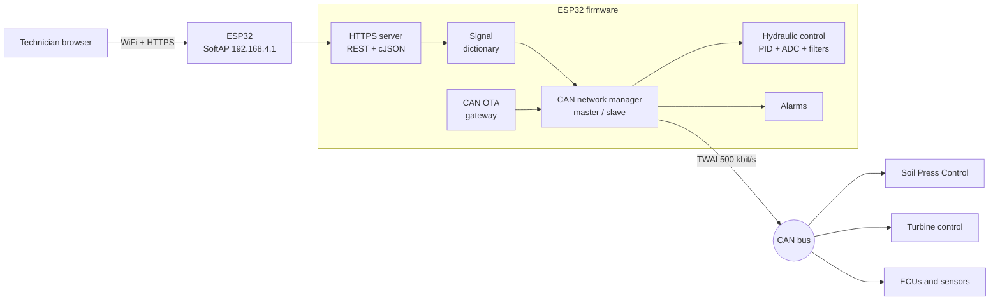

# ESP32 WiFi / CAN Configurator

**Embedded service console for industrial machinery: configuration, diagnostics and OTA updates over CAN, straight from the browser.**

[](https://docs.espressif.com/projects/esp-idf/)
[](https://www.espressif.com/en/products/socs/esp32)
[](https://isocpp.org/)
[](https://www.freertos.org/)
[](https://docs.espressif.com/projects/esp-idf/en/latest/esp32/api-reference/protocols/esp_https_server.html)
[](https://docs.espressif.com/projects/esp-idf/en/latest/esp32/api-reference/peripherals/twai.html)

[Español](README.md) | [English](README.en.md)

---

## What it is

A firmware that turns an **ESP32** into a service console for **industrial CAN networks**. The device brings up its own **WiFi Access Point**, serves an **HTTPS web interface**, and bridges a technician's browser to the nodes connected on the CAN bus.

From that interface, users can install nodes, configure hydraulic parameters, calibrate sensors, read live diagnostics, and update node firmware over CAN, **without a PC running proprietary software and without programming cables**.

Built in the context of agricultural and industrial control systems (soil pressure control and turbine control) at **LEAF Agrotronic SRL**.

---

## Highlights

- **Complete embedded web UI**: HTML, CSS and JavaScript compiled into the firmware. No external dependencies or CDNs.
- **Standalone HTTPS server**: the ESP32 creates the WiFi network and exposes the app at `https://192.168.4.1`.
- **Multi-node CAN management**: master/slave architecture, node addressing, periodic data polling, and connection loss detection.
- **OTA over CAN**: firmware upload from the browser, fragmentation into CAN frames, CRC32 verification, and real-time progress reporting.
- **Field configuration and calibration**: pressure sensors, actuator, PID loop, levels, ramps and alarms.
- **Robust concurrency**: prioritized FreeRTOS tasks and safe suspension of CAN traffic during an update.
- **Signal processing**: median, Kalman and moving-average filters, plus PID control for the hydraulic loop.

---

## Key features

| Area | Capability |
| --- | --- |
| Interface | Responsive web app served by the ESP32, no client installation |
| Connectivity | WiFi SoftAP + HTTPS server with a self-signed certificate |
| Fieldbus | CAN / TWAI at 500 kbit/s (TX GPIO27, RX GPIO26) |
| Nodes | Installation, replacement, memory erase and version query |
| Configuration | Currents, pressures, tolerances, levels, brightness, ramp and siren |
| Calibration | P1/P2/P3/P4 sensors, actuator and PID parameters |
| Diagnostics | Pressures, current, supply voltage, level and live alarms |
| Alarms | High/low pressure, hydraulic failure, electrical failure, slave disconnection |
| Persistence | Custom flash memory, NVS partition and FAT partition |
| Updates | Node OTA over CAN with CRC32, state machine and progress |
| CAN map | Discovery and visualization of connected nodes by address and version |

---

## Architecture



The firmware is organized in layers:

1. **Web layer**: HTTP routes, embedded views and JSON API.
2. **Data layer**: signal dictionary with timestamps, status and safe values.
3. **Network layer**: CAN messages, signal tables, PDU, counters and master/slave manager.
4. **Control layer**: ADC acquisition, digital filtering, PID and hydraulic control.
5. **System layer**: FreeRTOS tasks, timers, memory and alarms.

---

## Tech stack

| Category | Technology |
| --- | --- |
| Language | C and C++ (C99 / embedded C++) |
| Framework | ESP-IDF 5.3 |
| Operating system | FreeRTOS |
| Networking | WiFi SoftAP, TCP/IP, `esp_https_server` |
| Fieldbus | ESP32 TWAI controller, 500 kbit/s |
| Web | HTML, CSS and JavaScript embedded in flash |
| API | REST over HTTPS + JSON with cJSON |
| Storage | NVS, FAT and a custom memory manager |
| Tooling | CMake, `idf.py`, VS Code Dev Containers, Docker |

---

## Reference hardware

| Component | Purpose |
| --- | --- |
| ESP32 | Main controller, WiFi, HTTPS and CAN |
| CAN transceiver | Physical bus connection (TX GPIO27 / RX GPIO26) |
| ADC | Pressure 1, pressure 2, actuator current and battery voltage |
| PWM outputs | Hydraulic current control and indicator dimming |
| Buttons and LEDs | Local navigation and status indication |
| HT16K33 | I2C LED display/bar driver |
| TCA9555 | I2C I/O expander |
| 4 MB flash | Application, NVS and FAT storage |

Pins and peripherals are centralized in `main/hardDefinitions.h` and `main/can/can.h`.

---

## Getting started

### Requirements

- ESP-IDF **5.3** installed and exported in your environment.
- ESP32 board with 4 MB of flash.
- CAN transceiver connected to the bus.
- USB/serial port for flashing.

You can also work without a local installation using the included **Dev Container** (`.devcontainer/`), based on Espressif's official image.

### Build and flash

```bash
git clone https://github.com/maurop25984/FW_WiFi_CAN_Configurator.git
cd FW_WiFi_CAN_Configurator/ConfiguradorWiFi_CAN

idf.py set-target esp32
idf.py menuconfig
idf.py build
idf.py -p COMx flash monitor
```

Replace `COMx` with the correct serial port (`/dev/ttyUSB0` on Linux/macOS).

The partition table is already defined in `partitions.csv` for a 4 MB flash.

### First run

1. Connect to the WiFi network created by the ESP32:
   - **SSID:** `WiFiCANServerCfg`
   - **Password:** `m0rph30`
2. Open `https://192.168.4.1` in a browser.
3. Accept the self-signed certificate.
4. Choose a device: SoilPressControl, SoilPressControl V2, turbine control, CAN map or OTA.

AP credentials can be changed in `main/wifi_ap.h`.

---

## REST API

| Method | Route | Purpose |
| --- | --- | --- |
| GET | `/` | Main screen |
| GET | `/devOptionsView.html?device=...` | Device options |
| GET | `/configView.html` | Parameter configuration |
| GET | `/diagnosticView.html` | Live diagnostics |
| GET | `/installView.html` | Node installation |
| GET | `/eraseMemView.html` | Node memory erase |
| GET | `/canMapView.html` | CAN node map |
| GET | `/otaView.html` | OTA update interface |
| POST | `/api/set` | Read/write configuration and diagnostics |
| POST | `/api/event` | Installation, erase, configuration and calibration |
| POST | `/ota/upload` | Firmware upload to the CAN gateway |
| GET | `/ota/status` | Update status and progress |

Example configuration request:

```json
{
  "getConfig": true,
  "devAddress": 235
}
```

---

## OTA over CAN

1. The user selects a `.bin` file in the OTA view.
2. The ESP32 receives the firmware over HTTPS.
3. The gateway pauses CAN traffic tasks to avoid collisions.
4. The firmware is fragmented into numbered CAN packets with CRC.
5. The target node validates the data and reports its state.
6. The UI shows progress, sent packets and the final result.

Reserved CAN IDs for OTA: `0x600` to `0x604` (start, data, status, end and abort).

---

## Project structure

```text
ConfiguradorWiFi_CAN/
├── main/
│   ├── main.cpp                  # Startup and FreeRTOS tasks
│   ├── wifi_ap.c                 # SoftAP, HTTPS and REST routes
│   ├── wifiDataStructManager.c   # JSON serialization of node data
│   ├── adcProcess.*              # Analog acquisition and filtering
│   ├── hidraulicControl.*        # Hydraulic control and PID
│   ├── menuControl.*             # Local button navigation
│   ├── installNodes.*            # Node installation and replacement
│   ├── alarms/                   # Alarm management
│   ├── can/
│   │   ├── can.c                 # TWAI driver
│   │   ├── ecuNetworkManager.c   # Master/slave network
│   │   ├── ecuMessageManager.c   # CAN messages and signal tables
│   │   ├── pdu.c                 # Protocol data units
│   │   └── networkSubsystem.c    # Network subsystems
│   ├── Dictionary/               # Signal dictionary
│   ├── SpecificFunctions/        # Filters, timers, memory, CRC
│   ├── bootloader/               # CAN OTA gateway
│   └── views/                    # Embedded web interface
├── include/                      # Application tables and definitions
├── partitions.csv                # Partition layout for 4 MB flash
├── sdkconfig.defaults            # Base ESP-IDF configuration
└── .devcontainer/                # Reproducible development environment
```

---

## Engineering challenges solved

- Serving a full web application and a JSON API from a resource-constrained microcontroller with assets embedded in flash.
- Designing a master/slave CAN protocol with addressing, hot installation, command acknowledgement and cancellation.
- Implementing OTA over 8-byte CAN frames, including fragmentation, packet numbering, CRC32 and verification.
- Coordinating prioritized FreeRTOS tasks and safely suspending CAN traffic during an update.
- Conditioning analog signals with median, Kalman and moving-average filters before feeding the PID loop.
- Keeping the interface usable on mobile and desktop without frameworks or external dependencies.

---

## Roadmap

- [ ] Automated integration tests and CAN bus simulation.
- [ ] API authentication and access control.
- [ ] Detailed documentation of the CAN protocol and signal dictionary.
- [ ] Screenshots and demo video in the README.
- [ ] Support for additional ESP32 targets.
- [ ] Progressive migration to reusable component architecture.

---

## Author

**Mauro Pivetta** — Embedded Software Developer

- GitHub: [@maurop25984](https://github.com/maurop25984)
- Email: [maurofpivetta@gmail.com](mailto:maurofpivetta@gmail.com)
- Focus areas: ESP32 firmware, CAN, industrial IoT, automation and control systems.

Available for embedded development projects and technical consulting.


