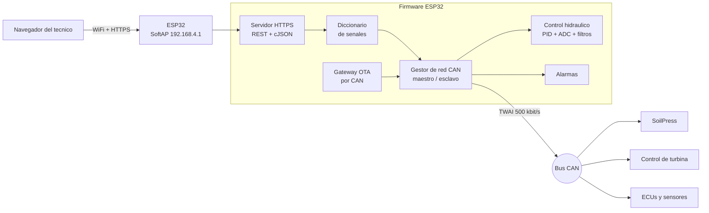

# Configurador WiFi / CAN para ESP32

**Consola de servicio embebida para maquinaria industrial: configuración, diagnóstico y actualización OTA sobre CAN, directamente desde el navegador.**

[](https://docs.espressif.com/projects/esp-idf/)
[](https://www.espressif.com/en/products/socs/esp32)
[](https://isocpp.org/)
[](https://www.freertos.org/)
[](https://docs.espressif.com/projects/esp-idf/en/latest/esp32/api-reference/protocols/esp_https_server.html)
[](https://docs.espressif.com/projects/esp-idf/en/latest/esp32/api-reference/peripherals/twai.html)

[Español](README.md) | [English](README.en.md)

---

## Qué es

Un firmware que convierte un **ESP32** en una consola de servicio para redes **CAN industriales**. El dispositivo levanta su propio **Access Point WiFi**, sirve una **interfaz web HTTPS** y actúa como puente entre el navegador de un técnico y los nodos conectados al bus CAN.

Desde la interfaz se pueden instalar nodos, configurar parámetros hidráulicos, calibrar sensores, leer diagnósticos en vivo y actualizar el firmware de los nodos por CAN, **sin una PC con software propietario y sin cables de programación**.

Desarrollado en el contexto de sistemas de control agrícola e industrial (SoilPress y control de turbina) de **LEAF Agrotronic SRL**.

---

## Por qué destaca

- **Interfaz web embebida completa**: HTML, CSS y JavaScript compilados dentro del firmware. Sin dependencias externas ni CDN.
- **Servidor HTTPS autónomo**: el ESP32 crea la red WiFi y expone la aplicación en `https://192.168.4.1`.
- **Gestión de red CAN multipropósito**: arquitectura maestro/esclavo, direccionamiento de nodos, consulta periódica de datos y detección de conexión/desconexión.
- **OTA por CAN**: carga de firmware desde el navegador, fragmentación en tramas CAN, verificación por CRC32 y reporte de progreso en tiempo real.
- **Configuración y calibración de campo**: sensores de presión, actuador, lazo PID, niveles, rampas y alarmas.
- **Concurrencia robusta**: tareas FreeRTOS con prioridades y suspensión segura del tráfico CAN durante una actualización.
- **Procesamiento de señales**: filtros de mediana, Kalman y promedio móvil, más control PID para el lazo hidráulico.

---

## Características principales

| Área | Capacidad |
| --- | --- |
| Interfaz | Web app responsive servida desde el ESP32, sin instalación en el cliente |
| Conectividad | WiFi SoftAP + servidor HTTPS con certificado autofirmado |
| Red de campo | CAN / TWAI a 500 kbit/s (TX GPIO27, RX GPIO26) |
| Nodos | Instalación, reemplazo, borrado de memoria y consulta de versión |
| Configuración | Corrientes, presiones, tolerancias, niveles, brillo, rampa y sirena |
| Calibración | Sensores P1/P2/P3/P4, actuador y parámetros PID |
| Diagnóstico | Presiones, corriente, tensión de alimentación, nivel y alarmas en vivo |
| Alarmas | Presión alta/baja, falla hidráulica, falla eléctrica, desconexión de esclavos |
| Persistencia | Memoria propia en flash, partición NVS y partición FAT |
| Actualización | OTA de nodos vía CAN con CRC32, estados y progreso |
| Mapa CAN | Descubrimiento y visualización de nodos conectados por dirección y versión |

---

## Arquitectura



El firmware se organiza en capas:

1. **Capa web**: rutas HTTP, vistas embebidas y API JSON.
2. **Capa de datos**: diccionario de señales con timestamp, estado y valores de seguridad.
3. **Capa de red**: mensajes CAN, tablas de señales, PDU, contadores y gestor maestro/esclavo.
4. **Capa de control**: adquisición ADC, filtrado digital, PID y control hidráulico.
5. **Capa de sistema**: tareas FreeRTOS, temporizadores, memoria y alarmas.

---

## Stack técnico

| Categoría | Tecnología |
| --- | --- |
| Lenguaje | C y C++ (C99 / C++ embebido) |
| Framework | ESP-IDF 5.3 |
| Sistema operativo | FreeRTOS |
| Red | WiFi SoftAP, TCP/IP, `esp_https_server` |
| Fieldbus | Controlador TWAI de ESP32, 500 kbit/s |
| Web | HTML, CSS y JavaScript embebidos en flash |
| API | REST sobre HTTPS + JSON con cJSON |
| Almacenamiento | NVS, FAT y gestor de memoria propio |
| Herramientas | CMake, `idf.py`, VS Code Dev Containers, Docker |

---

## Hardware de referencia

| Componente | Uso |
| --- | --- |
| ESP32 | Controlador principal, WiFi, HTTPS y CAN |
| Transceptor CAN | Conexión física al bus (TX GPIO27 / RX GPIO26) |
| ADC | Presión 1, presión 2, corriente del actuador y tensión de batería |
| Salidas PWM | Control de corriente hidráulica y dimmer de indicadores |
| Pulsadores y LEDs | Navegación local y señalización |
| HT16K33 | Driver de display/barra LED por I2C |
| TCA9555 | Expansor de E/S por I2C |
| Flash de 4 MB | Aplicación, NVS y almacenamiento FAT |

Los pines y periféricos están centralizados en `main/hardDefinitions.h` y `main/can/can.h`.

---

## Puesta en marcha

### Requisitos

- ESP-IDF **5.3** instalado y exportado en el entorno.
- Placa ESP32 con 4 MB de flash.
- Transceptor CAN conectado al bus.
- Puerto USB/serial para flashear.

También se puede trabajar sin instalar nada localmente usando el **Dev Container** incluido (`.devcontainer/`), basado en la imagen oficial de Espressif.

### Compilar y flashear

```bash
git clone https://github.com/maurop25984/FW_WiFi_CAN_Configurator.git
cd FW_WiFi_CAN_Configurator/ConfiguradorWiFi_CAN

idf.py set-target esp32
idf.py menuconfig
idf.py build
idf.py -p COMx flash monitor
```

Reemplazar `COMx` por el puerto serie correspondiente (`/dev/ttyUSB0` en Linux/macOS).

La tabla de particiones ya está definida en `partitions.csv` para una flash de 4 MB.

### Primer uso

1. Conectar el equipo a la red WiFi generada por el ESP32:
   - **SSID:** `WiFiCANServerCfg`
   - **Password:** `m0rph30`
2. Abrir `https://192.168.4.1` en el navegador.
3. Aceptar el certificado autofirmado.
4. Elegir el dispositivo: SoilPress, SoilPress V2, control de turbina, mapa CAN u OTA.

Las credenciales del AP se cambian en `main/wifi_ap.h`.

---

## API REST

| Método | Ruta | Función |
| --- | --- | --- |
| GET | `/` | Pantalla principal |
| GET | `/devOptionsView.html?device=...` | Opciones del dispositivo |
| GET | `/configView.html` | Configuración de parámetros |
| GET | `/diagnosticView.html` | Diagnóstico en vivo |
| GET | `/installView.html` | Instalación de nodos |
| GET | `/eraseMemView.html` | Borrado de memoria de nodos |
| GET | `/canMapView.html` | Mapa de nodos CAN |
| GET | `/otaView.html` | Interfaz de actualización OTA |
| POST | `/api/set` | Lectura/escritura de configuración y diagnóstico |
| POST | `/api/event` | Instalación, borrado, configuración y calibración |
| POST | `/ota/upload` | Carga de firmware hacia el gateway CAN |
| GET | `/ota/status` | Estado y progreso de la actualización |

Ejemplo de consulta de configuración:

```json
{
  "getConfig": true,
  "devAddress": 235
}
```

---

## OTA por CAN

1. El usuario selecciona un archivo `.bin` desde la vista OTA.
2. El ESP32 recibe el firmware por HTTPS.
3. El gateway pausa las tareas de tráfico CAN para evitar colisiones.
4. El firmware se fragmenta en paquetes CAN con numeración y CRC.
5. El nodo destino valida los datos y confirma el estado.
6. La interfaz muestra progreso, paquetes enviados y resultado final.

Identificadores CAN reservados para OTA: `0x600` a `0x604` (inicio, datos, estado, fin y aborto).

---

## Estructura del proyecto

```text
ConfiguradorWiFi_CAN/
├── main/
│   ├── main.cpp                  # Arranque y tareas FreeRTOS
│   ├── wifi_ap.c                 # SoftAP, HTTPS y rutas REST
│   ├── wifiDataStructManager.c   # Serializacion JSON de datos de nodos
│   ├── adcProcess.*              # Adquisicion y filtrado de senales analogicas
│   ├── hidraulicControl.*        # Control hidraulico y PID
│   ├── menuControl.*             # Navegacion local por pulsadores
│   ├── installNodes.*            # Instalacion y reemplazo de nodos
│   ├── alarms/                   # Gestion de alarmas
│   ├── can/
│   │   ├── can.c                 # Driver TWAI
│   │   ├── ecuNetworkManager.c   # Red maestro/esclavo
│   │   ├── ecuMessageManager.c   # Mensajes y tablas CAN
│   │   ├── pdu.c                 # Unidades de datos de protocolo
│   │   └── networkSubsystem.c    # Subsistemas de red
│   ├── Dictionary/               # Diccionario de senales
│   ├── SpecificFunctions/        # Filtros, timers, memoria, CRC
│   ├── bootloader/               # Gateway OTA por CAN
│   └── views/                    # Interfaz web embebida
├── include/                      # Tablas y definiciones de aplicacion
├── partitions.csv                # Particiones para flash de 4 MB
├── sdkconfig.defaults            # Configuracion base de ESP-IDF
└── .devcontainer/                # Entorno de desarrollo reproducible
```

---

## Desafíos técnicos resueltos

- Servir una aplicación web completa y una API JSON desde un microcontrolador con recursos limitados, embebiendo los assets en flash.
- Diseñar un protocolo CAN maestro/esclavo con direccionamiento, instalación en caliente, confirmación y cancelación de comandos.
- Implementar OTA sobre tramas CAN de 8 bytes, incluyendo fragmentación, numeración de paquetes, CRC32 y verificación.
- Coordinar tareas FreeRTOS con prioridades y suspender el tráfico CAN de forma segura durante una actualización.
- Acondicionar señales analógicas con filtros de mediana, Kalman y promedio móvil antes de alimentar el lazo PID.
- Mantener una interfaz usable en móvil y escritorio sin frameworks ni dependencias externas.

---

## Roadmap

- [ ] Pruebas automatizadas de integración y simulación de bus CAN.
- [ ] Autenticación y control de acceso en la API.
- [ ] Documentación detallada del protocolo CAN y del diccionario de señales.
- [ ] Capturas de pantalla y video demo en el README.
- [ ] Soporte para nuevos targets de ESP32.
- [ ] Migración progresiva a una arquitectura de componentes reutilizables.

---

## Autor

**Mauro Pivetta** — Desarrollador de software embebido

- GitHub: [@maurop25984](https://github.com/maurop25984)
- Email: [maurofpivetta@gmail.com](mailto:maurofpivetta@gmail.com)
- Áreas: firmware ESP32, CAN, IoT industrial, automatización y sistemas de control.

Disponible para proyectos de desarrollo embebido y consultoría técnica.


